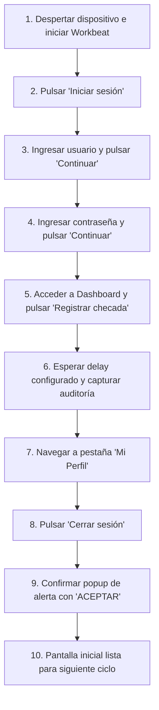

# Robot-SuperApp-WB

Sistema automatizado de **Android containerizado en Docker** sobre hardware **Orange Pi 4 Pro (ARM64)** con soporte para **GPS físico USB (VK-162)** para ejecutar aplicaciones móviles que requieren verificación de ubicación real (Check-in / asistencia) sin ser detectadas como ubicaciones simuladas (*Mock Location*).

---

## 🎯 Objetivo y Enfoque de Seguridad

Las aplicaciones móviles modernas (corporativas, bancarias, control de asistencia como **Workbeat**) detectan y bloquean el uso de ubicaciones falsas inspeccionando:
1. `Location.isFromMockProvider()` en el SDK de Android.
2. La bandera de opciones de desarrollo `ALLOW_MOCK_LOCATION`.
3. Paquetes instalados de aplicaciones populares de *Fake GPS*.
4. Redes Wi-Fi y celdas de telefonía discrepantes.

### ¿Por qué hardware físico?
Para eludir estas restricciones de manera 100% limpia y a nivel de hardware:
- Se utiliza una placa **Orange Pi 4 Pro** (SoC Rockchip RK3399 ARM64) que ejecuta contenedores Android nativos sin sobrecarga de emulación.
- Se conecta un receptor **GPS USB VK-162 (u-blox 7)** que recibe señales satelitales GNSS reales en tiempo real (NMEA 0183).
- Las tramas del GPS se pasan directamente a través de passthrough USB serial (`/dev/ttyACM0` o `/dev/ttyUSB0`) al subsistema de ubicación del HAL de Android, haciendo que el sistema operativo registre la ubicación como un proveedor de hardware real (`GPS_PROVIDER`), con `isFromMockProvider() == false`.

---

## 🛠️ Requisitos de Hardware y Software

| Componente | Detalle |
| :--- | :--- |
| **SBC** | Orange Pi 4 Pro (Rockchip RK3399, 4GB RAM, ARM64) |
| **Módulo GPS** | VK-162 USB (Chipset u-blox 7 / G7020-KT, 9600 baudios) |
| **Sistema Operativo** | Armbian (Ubuntu/Debian) para RK3399 con kernel 5.x o 6.x |
| **Contenedor** | [ReDroid](https://github.com/remote-android/redroid-doc) (Android 11 ARM64) |
| **Servicios de Google** | [microG GmsCore](https://github.com/microg/GmsCore) (Proveedor ligero de `FusedLocation`) |
| **Herramientas** | Docker, Docker Compose, ADB, Python 3.8+ |

---

## 📁 Estructura del Proyecto

```text
Robot-SuperApp-WB/
├── README.md                           # Documentación técnica del proyecto
├── docker-compose.yml                  # Configuración de ReDroid con passthrough de GPS USB
├── .gitignore                          # Exclusiones de Git (logs, sesiones, capturas, APKs)
├── .config/
│   ├── .gitkeep                        # Directorio para archivos .yaml de configuración de usuario
│   └── diegol.yaml.example             # Plantilla de ejemplo para sesiones
├── Screenshots-Temp/
│   └── .gitkeep                        # Carpeta local para capturas de auditoría (excluida en git)
├── configs/
│   └── udev/
│       └── 99-vk162-gps.rules          # Reglas udev para asignar permisos fijos al VK-162
└── scripts/
    ├── setup_host.sh                   # Script para configurar kernel binder, udev y paquetes en Orange Pi
    ├── test_gps.py                     # Script para validar lectura NMEA y fix del GPS (Mac y Linux)
    └── automation/
        ├── requirements.txt            # Dependencias Python
        └── bot_checkin.py              # Robot de check-in automatizado para Workbeat
```

---

## 📱 Aplicación Objetivo: Workbeat Mobile

* **Paquete:** `com.workbeatmobile`
* **Actividad Principal:** `com.superappworkbeat.MainActivity`
* **Arquitectura:** React Native universal (`arm64-v8a` nativo para RK3399)
* **Integridad de Google:** **No requiere Play Integrity ni SafetyNet estricto**.
* **Ubicación:** Requiere Google Play Services para `FusedLocationProviderClient`. Se resuelve instalando **microG (GmsCore)** dentro del contenedor ReDroid, lo que consume solo ~35 MB de RAM y redirige las llamadas de ubicación al GPS VK-162 físico.

---

## 🤖 Flujo Automatizado del Robot de Check-in

El script [`scripts/automation/bot_checkin.py`](scripts/automation/bot_checkin.py) implementa un flujo dinámico guiado por la jerarquía de UIAutomator (independiente de la resolución de pantalla):



### Configuración por archivos YAML (`.config/`)

Puedes definir usuarios y parámetros en archivos YAML dentro de `.config/` (por ejemplo `.config/diegol.yaml`):

```yaml
USER: PINTACOMEX\2469618
PASS: TuPassword123/
# Segundos de espera tras pulsar el botón de registro
SCREENSHOT_DELAY: 5
```

### Opciones de Ejecución del Bot

```bash
# 1. Ejecutar usando un archivo de configuración:
python3 scripts/automation/bot_checkin.py --config .config/diegol.yaml

# 2. Pasar parámetros directamente por CLI:
python3 scripts/automation/bot_checkin.py -u "PINTACOMEX\2469618" -p "TuPassword" -d 5

# 3. Especificar un dispositivo ADB específico:
python3 scripts/automation/bot_checkin.py -c diegol -s localhost:5555
```

| Parámetro | Abreviatura | Descripción |
| :--- | :--- | :--- |
| `--config` | `-c` | Ruta al archivo `.yaml` (por defecto `.config/diegol.yaml`) |
| `--user` | `-u` | Usuario o código de empleado (ej. `PINTACOMEX\2469618`) |
| `--password` | `-p` | Contraseña de acceso |
| `--delay` | `-d` | Tiempo de espera en segundos tras checar |
| `--device` | `-s` | Serial o `host:puerto` de ADB |
| `--screenshot-dir` | | Carpeta de capturas (por defecto `Screenshots-Temp`) |

### Registro de Auditoría Visual (`Screenshots-Temp/`)

En cada fase del proceso se guardan capturas cronológicas:
* `01_app_iniciada_*.png`: Bienvenida inicial.
* `02_usuario_ingresado_*.png`: Formulario con el usuario ingresado.
* `03_password_ingresado_*.png`: Contraseña colocada y teclado oculto.
* `04_dashboard_inicio_*.png`: Dashboard con la tarjeta de asistencia visible.
* `05_checada_registrada_*.png`: Confirmación de pulsación de checada.
* `06_pantalla_perfil_*.png`: Vista de perfil.
* `07_sesion_cerrada_*.png`: Sesión cerrada de forma segura.

---

## 🚀 Guía de Puesta en Marcha en la Orange Pi 4 Pro

### Paso 1: Preparación del Host

1. Clona el repositorio en tu Orange Pi:
   ```bash
   git clone https://github.com/liconarrbt/Robot-SuperApp-WB.git
   cd Robot-SuperApp-WB
   ```

2. Ejecuta el script de aprovisionamiento como `sudo`:
   ```bash
   sudo ./scripts/setup_host.sh
   ```
   Carga los módulos `binder_linux` (`binder,hwbinder,vndbinder`), instala reglas udev y paquetes esenciales.

### Paso 2: Prueba del GPS Físico VK-162

Conecta el módulo USB a la Orange Pi y ejecuta el test:
```bash
python3 scripts/test_gps.py
```
Verifica que las sentencias NMEA reporten **`FIX 3D ACTIVO`** y coordenadas válidas.

### Paso 3: Iniciar el Contenedor ReDroid

1. Levanta el contenedor con Docker Compose:
   ```bash
   docker compose up -d
   ```

2. Conéctate por ADB:
   ```bash
   adb connect localhost:5555
   adb devices
   ```

### Paso 4: Instalar microG y Workbeat en el Contenedor

1. Instala microG GmsCore para habilitar `FusedLocationProviderClient`:
   ```bash
   adb -s localhost:5555 install GmsCore.apk
   ```

2. Instala la aplicación Workbeat:
   ```bash
   adb -s localhost:5555 install apk/workbeat.apk
   ```

3. Otorga los permisos de ubicación en tiempo de ejecución:
   ```bash
   adb -s localhost:5555 shell pm grant com.workbeatmobile android.permission.ACCESS_FINE_LOCATION
   adb -s localhost:5555 shell pm grant com.workbeatmobile android.permission.ACCESS_COARSE_LOCATION
   ```

### Paso 5: Ejecutar la Automatización

Crea tu archivo de sesión en `.config/tu_usuario.yaml` y lanza el robot:
```bash
python3 scripts/automation/bot_checkin.py --config .config/tu_usuario.yaml -s localhost:5555
```

---

## 📌 Consejos y Buenas Prácticas

- **Recepción GPS en Interiores**: Si operas la Orange Pi en interiores, ubica la antena del VK-162 cerca de una ventana para garantizar Fix continuo.
- **Acceso Gráfico Opcional**: Conéctate por `scrcpy` desde tu PC para ver la interfaz en tiempo real:
  ```bash
  scrcpy -s <ip-orange-pi>:5555
  ```
- **Persistencia**: Todos los datos de la sesión de Android se conservan en `./data`.

---

## 📄 Licencia

Este proyecto está bajo la licencia MIT.
